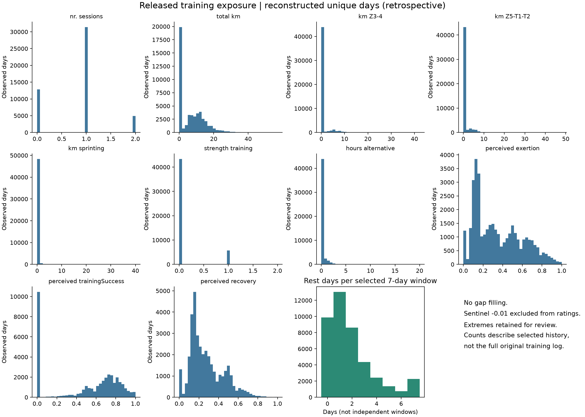
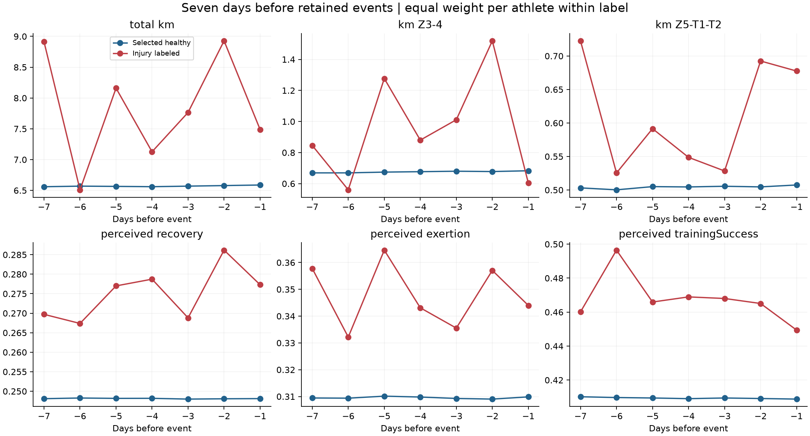
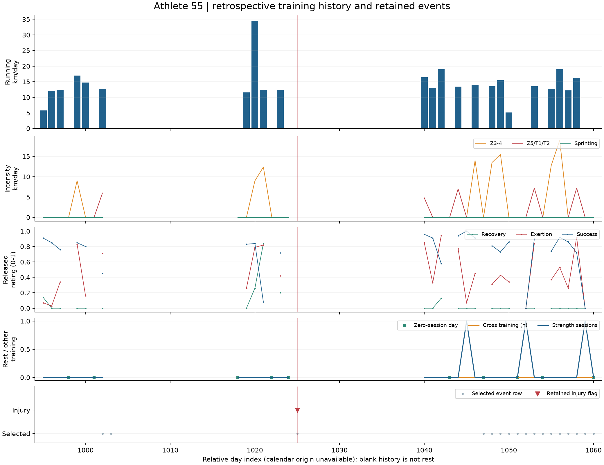
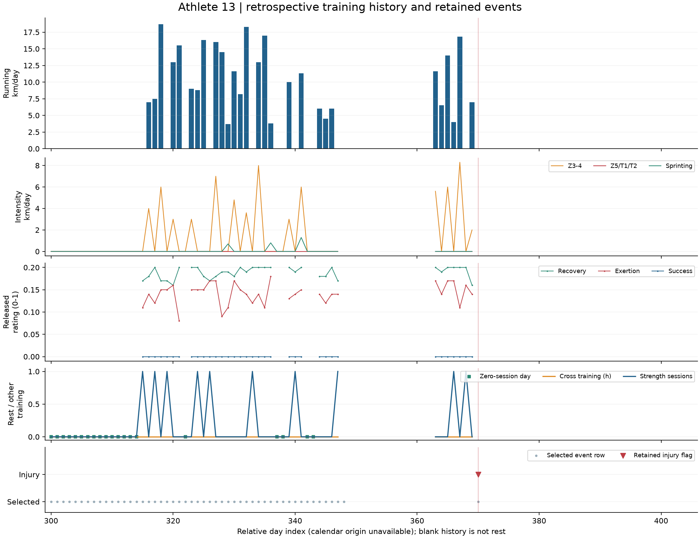
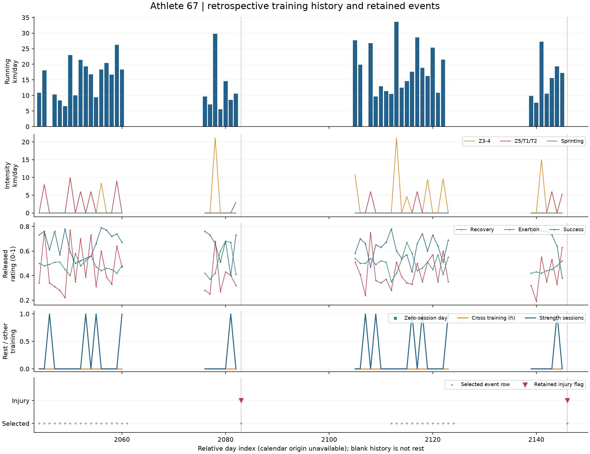
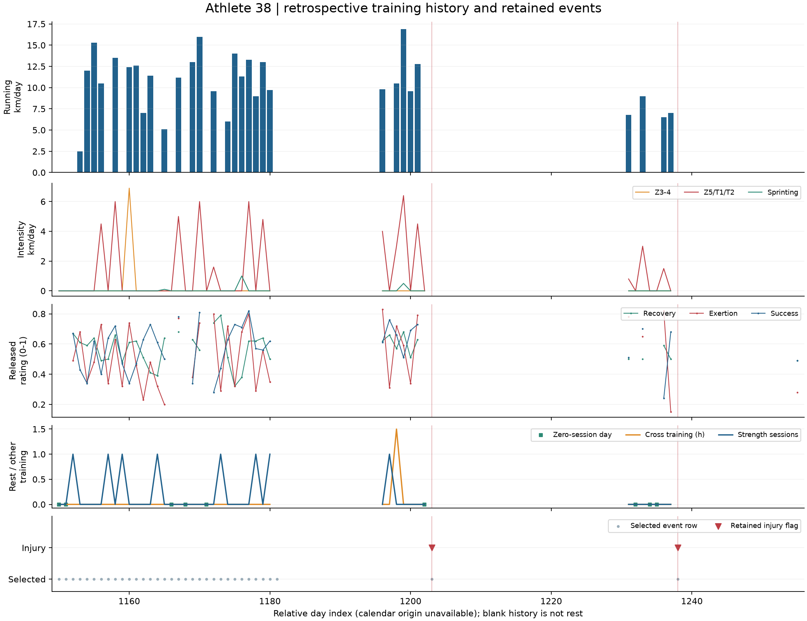
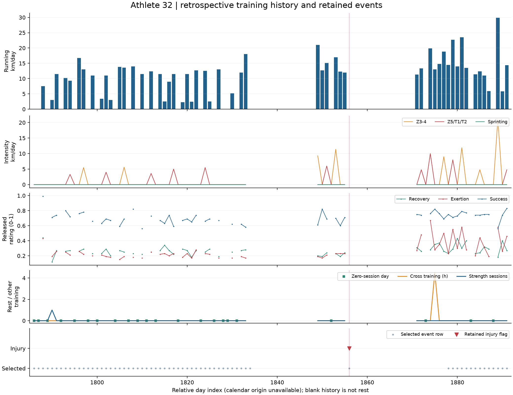

> Historical Milestone 1 record. The user authorized continuation; current results are in [Phase 2](phase_02_summary.md).

# Milestone 1 - Longitudinal Dataset & Injury Event Understanding

**Longitudinal Training Load & Injury Risk in Competitive Runners**  
Sports Rehabilitation & Human Performance | Physiotherapy Data Science portfolio  
Review date: 2026-10-25 | Original Dataverse release 2.0 | **Milestone 1 complete; STOP before modeling**

## Findings at a glance

| Representation | Athletes | Rows | Injury labels | Label prevalence (%) | Athletes with labels |
|---|---|---|---|---|---|
| Day | 74 | 42766 | 583 | 1.363 | 63 |
| Week | 74 | 42798 | 575 | 1.344 | 61 |

Counts are calculated from downloaded files; no cohort/event size is hard-coded. Injury prevalence is **the fraction of retained event rows labeled injury**, not an annual injury rate or a prospective daily probability.

## What does one row represent?

A selected event day for a masked athlete with a binary injury/healthy label and an embedded earlier training history. It is not a raw unfiltered athlete-day. Day contains 70 exposure/response fields (10 x 7) plus athlete ID, target and Date. Week contains 66 weekly fields (22 x 3), three weekly ratios, athlete ID, target and Date. Day and Week are overlapping representations of different selected event sets, not independent cohorts.

## What constitutes an injury event?

A retained training-log flag for interruption or skipping of a scheduled session because of injury. Creators required three preceding injury-free weeks; further flags within three weeks were excluded as the same episode. Healthy comparisons required full fitness for three weeks before **and after** E. Missing/anomalous events were excluded. See [target definition](../docs/injury_definition.md) and the source study's Methods, pp. 1523-1524. A flag is not a verified anatomical diagnosis, severity category or exact biological onset date.

## How rare are injuries?

Day: 583 of 42,766 (1.3632%). Week: 575 of 42,798 (1.3435%). All-negative accuracy would be 98.64% in Day, illustrating why accuracy is unsuitable. This arithmetic is not a trained model. Future average-precision no-skill reference is the evaluation-set label fraction, subject to the same sampling caveat.

63 Day athletes and 61 Week athletes have a retained flag. In Day, labels per athlete range 0-35, median 5; full counts are in [day_athlete_summary.csv](tables/day_athlete_summary.csv).

There are 520 computable within-athlete intervals between retained Day injury labels: median 77 days, IQR 47-130.25, range 22-877. Week median is 78.5. **No consecutive injury labels exist** in either file; minimum interval is 22 days, consistent with creator filtering. Do not interpret this as absence of prolonged injuries or early recurrence in the original logs.

## How much longitudinal history exists per athlete?

- Selected Day event rows: median 426.5, IQR 269.0-753.0, range 43-1791.
- Inclusive selected-event spans: median 801 days; range 43-2653. These are retained spans, not continuous follow-up or days at risk.
- Event Date ranges **0 to 2673 relative days** in both representations. Exact earliest/latest calendar dates are unavailable. Source collection is approximately 2012-2019; no day/month is invented.
- 35,609 days inside athlete Day event spans have no selected row. Their cause cannot be identified. [Gap table](tables/day_observation_gaps.csv) preserves all intervals. Missing event rows are not rest or healthy days.
- Day history expands to 299,362 overlapping athlete-history rows but only **49,162 unique athlete-training days**, indices -7 to 2672. Overlap conflicts: 0. Reconstruction does not recover the complete log and is descriptive only.

All athlete-specific spans, observation counts, gaps, label counts, scale usage and reconstructed-history coverage are exported, rather than only population aggregates. Sex is unavailable by ID. Source retained cohort metadata reports 27 women/47 men. The 77 initially described in Subjects becomes 74 after filtering in Design; see [cohort definition](../docs/cohort_definition.md).

## What training information exists before injury?

Daily completed sessions, running km, Z3-4 km, Z5/T1/T2 km, sprint km, logged strength, cross-training hours, perceived exertion, recovery and training success over seven days. Weekly summaries add rest counts, maxima, tough/interval session counts and three weeks of aggregate history. Training duration, explicit easy-zone km, sleep and HRV are not released. Intensity-zone definitions and every exact column appear in the [data dictionary](../docs/data_dictionary.md).

### Distributions on unique reconstructed training days

| variable | n | missing | mean | median | q25 | q75 | p99 | max |
|---|---|---|---|---|---|---|---|---|
| nr. sessions | 49162 | 0 | 0.838 | 1.000 | 0.000 | 1.000 | 2.000 | 2.000 |
| total km | 49162 | 0 | 7.068 | 6.000 | 0.000 | 12.000 | 29.000 | 57.000 |
| km Z3-4 | 49162 | 0 | 0.699 | 0.000 | 0.000 | 0.000 | 10.000 | 42.200 |
| km Z5-T1-T2 | 49162 | 0 | 0.595 | 0.000 | 0.000 | 0.000 | 8.000 | 48.000 |
| km sprinting | 49162 | 0 | 0.076 | 0.000 | 0.000 | 0.000 | 1.500 | 40.000 |
| strength training | 49162 | 0 | 0.120 | 0.000 | 0.000 | 0.000 | 1.000 | 2.000 |
| hours alternative | 49162 | 0 | 0.165 | 0.000 | 0.000 | 0.000 | 2.500 | 20.000 |
| perceived exertion | 36302 | 12860 | 0.349 | 0.290 | 0.140 | 0.530 | 0.920 | 1.000 |
| perceived trainingSuccess | 36302 | 12860 | 0.490 | 0.620 | 0.000 | 0.770 | 0.980 | 1.000 |
| perceived recovery | 36302 | 12860 | 0.275 | 0.220 | 0.150 | 0.380 | 0.750 | 1.000 |

Subjective missing counts here are deliberately masked rest sentinels, not blank source cells. There are 12,860 zero-session days (26.16% of reconstructed days). A zero-running day can still contain strength/cross training; rest is defined from zero sessions. The selected-window rest distribution is exported separately.

## Missing data, coding and quality

Both released files contain zero blank/nonfinite cells and zero duplicate athlete/event keys. This follows creator filtering and does not prove complete raw surveillance. Day windows contain 241,047 subjective -0.01 cells: all occur on zero-session days, with no ordinary ratings on those rest days. They are excluded from rating means, while exposure days remain. All-rest seven-day windows: 2,282, including 5 injury-labeled rows. Their subjective averages are undefined in our daily summaries; weekly source summaries use zero, so direct rating comparisons need care.

Fifteen athletes have all-zero recorded training-success ratings across reconstructed active histories. We preserve zeros, flag the pattern and do not silently call zero missing or success. Scale anchors/transformations are insufficiently documented for a clinical score interpretation. Per-variable and per-athlete missingness plus scale-use tables are in `reports/tables/`.

170 reconstructed training days meet transparent review triggers (large distance/sprint/cross-training values, strength >1, or intensity exceeding total). These triggers are screening rules, not proof of error. Original values remain. Weekly ratios reach over 200 million; zero-denominator cases and consistency errors are documented in [released_ratio_audit.csv](tables/released_ratio_audit.csv). No predictive use is authorized.

## What do pre-event patterns show?

The following are equal-athlete-weight **within-athlete** differences between each athlete's mean injury and mean healthy windows. They are different from raw population mean differences. CIs resample paired athlete contrasts 2,000 times; effect size is mean paired difference/SD of those differences. Objective features include 63 paired athletes; subjective features include 62 after undefined means are excluded. No time-varying confounding adjustment or multiplicity correction is applied.

| feature | paired_athletes | injury_minus_healthy | ci95_low | ci95_high | paired_standardized_difference |
|---|---|---|---|---|---|
| sessions_7d | 63 | 0.548 | 0.315 | 0.781 | 0.562 |
| distance_7d | 63 | 8.164 | 4.597 | 11.516 | 0.594 |
| z3_4_distance_7d | 63 | 1.918 | 0.760 | 3.020 | 0.417 |
| z5_t1_t2_distance_7d | 63 | 0.848 | 0.263 | 1.438 | 0.355 |
| sprint_distance_7d | 63 | 0.543 | 0.015 | 1.414 | 0.172 |
| strength_sessions_7d | 63 | 0.089 | -0.028 | 0.202 | 0.188 |
| cross_training_hours_7d | 63 | -0.140 | -0.407 | 0.154 | -0.120 |
| rest_days_7d | 63 | -0.496 | -0.674 | -0.312 | -0.660 |
| mean_exertion_7d | 62 | 0.025 | 0.008 | 0.042 | 0.354 |
| mean_training_success_7d | 62 | 0.040 | 0.008 | 0.076 | 0.287 |
| mean_recovery_7d | 62 | 0.023 | 0.007 | 0.040 | 0.332 |

More volume, more Z3-4/Z5-T1-T2 distance, more sessions and fewer rest days precede retained injury labels in this comparison. **Perceived recovery is also higher**, as are exertion and success; lower-recovery assumptions are not supported by these summaries. Recording habits, source selection, temporal trends and training exposure may contribute. Strength and cross-training contrasts remain uncertain. Sprint results are particularly sensitive to extreme values. None establishes that a load or recovery change causes or prevents injury, or that intensity adds information independently of total volume.

3-day comparisons, raw per-label distributions, athlete-level paired values and separate Week-0 results are exported. The trajectory plot below weights athletes equally within each label, but label groups differ in athlete membership, so its curves are descriptive and not the paired estimator above.

## Athlete timelines

Five athletes were selected deterministically from injured athletes across retained-observation-count quantiles: 55, 13, 67, 38, 32. Each figure shows running distance, intensity, perceived response, rest/other training and retained events with relative-day spacing. Gaps are blank. Training reconstructed from later windows is used only to visualize retrospective history; never as proof of prospective availability.

## Which variables might leak future information?

Future-conditioned healthy selection is the main upstream problem. Full-athlete healthy-label means/SD, future normalization, days until next event/injury, reconstructed history available only through later source windows, outcome-derived missingness and cross-fold athlete overlap are additional risks. `Athlete ID`, `Date`, `injury` and reconstruction provenance are not exposure predictors. See [feature-by-feature leakage audit](../docs/leakage_audit.md).

The original replication code was read but never executed. It holds out athletes, but its test-athlete healthy normalization uses full held-out athlete records and outcome labels. Training and calibration draws are taken from the same original observation pool and can overlap. The test threshold is passed from validation; using test labels to compute evaluation metrics is not itself leakage. Historical reported AUCs are not a leakage-free deployment benchmark. A recent temporal benchmark is listed in [references](../docs/references.md), but its stated daily suffix order conflicts with the corrected source README; the source correction governs our implementation.

## Athlete-level and temporal dependencies

Athlete-days are nested within 74 athletes; they are not 42,766 independent people. There are 41,700 adjacent retained Day event pairs whose seven-day histories share six exposure days. Repeated labels, personal rating habits, unequal history length and team context affect uncertainty. Random row splitting is not an unseen-athlete evaluation; a pure chronological split does not alone prevent overlap of input histories. Descriptive clustering, later athlete-disjoint folds and temporal purging address different aspects.

## What can this dataset legitimately predict?

After review, it can support carefully bounded retrospective estimation/classification of a **selected injury-labeled event day from preceding training windows**, and compare known-athlete temporal versus unseen-athlete generalization under explicitly specified protocols. This milestone demonstrates data availability and associations only; no predictive ability is claimed.

## What can it NOT tell us?

It cannot establish deterministic injury, medically verified diagnosis, injury mechanism, true cohort incidence, fully observed time at risk, treatment effects, safe load thresholds, injury prevention, complete recovery trajectories or transportability to recreational runners. Prospective real-world probability calibration and operational alert rates require representative ongoing surveillance. A complementary cohort cannot supply missing HRV/sleep or biomechanics for these same individuals.

## Day or Week as primary representation?

**Day Approach is primary** for daily trajectories, subjective-response audit and sequence-preserving descriptive work. It is not chosen because of the original AUC. Week remains a separate secondary representation for direct 14/21-day exposure and week-to-week comparisons. Do not reconstruct unobserved long histories by silently stitching selected rows.

Cross-file audit: 42,680 matched athlete/event keys, 86 Day-only and 118 Week-only; no label disagreements on matched keys. Seven-day objective sums reconcile exactly on common keys except small cross-training rounding differences. Weekly subjective averages are rounded and all-rest cases differ in missing-value handling. The two files must not be stacked.

## Candidate windows and Phase 2

Implemented descriptively: 3/7-day exposure, rest and subjective summaries with observed-rating counts. Proposed: 14/21-day weekly totals, week-to-week differences and prior-only personal deviations. Defer 28-day features until complete as-of history is established. Register a few physiological hypotheses; avoid arbitrary interactions or ACWR as a clinical truth. See [feature registry](../handoff/feature_catalog.csv) and [Phase 2 proposal](../docs/phase_02_proposal.md).

Complementary-data acquisition/review was opened in parallel at the user's request; see [source review](../docs/complementary_dataset_review.md) and [integration contract](../handoff/future_integration.md). Cohorts, IDs and outcomes remain separate.

Two complementary sources are now acquired and profiled: **SoccerMon** provides a working source-specific wellness/session adapter for 50 elite soccer athletes; **Wu 2026** provides multidisciplinary processed runner workbooks, but no explicit participant/time keys. Their acquisition, file-level profiles, dataset catalog and domain mapping are prepared now. Wu is quarantined for longitudinal/grouped modeling, and SoccerMon has its own reporting and availability limitations. See [complementary data profile](../docs/complementary_data_profile.md). Neither source fills missing measurements in the Dutch runners.

## Deliverable checklist

| Requested deliverables | Review location |
|---|---|
| 1 Repository structure; 2 acquisition; 3 exact files | README, data/README, source manifest |
| 4 dictionary | docs/data_dictionary.md and column-complete CSV |
| 5 athletes; 6 rows; 7 date range | Computed audit and findings table above |
| 8 observations/athlete; 9 follow-up | day/week_athlete_summary.csv; retained-span caveat above |
| 10 labels; 11 prevalence; 12 injured athletes; 13 labels/athlete | audit_summary.json and athlete tables |
| 14 intervals; 15 consecutive labels | day/week_injury_intervals.csv; minimum 22 days |
| 16 missingness | per-variable/per-athlete tables; sentinel and scale-use audits |
| 17 volume; 18 intensity; 19 rest; 20 recovery; 21 exertion; 22 success | Distribution tables and figure above |
| 23 five timelines | Five figures above; notebook 02 |
| 24 pre-event comparison | 3/7-day and Week-0 contrasts, CI/effect sizes, profiles |
| 25 target; 26 leakage | injury_definition.md; leakage_audit.md |
| 27 athlete dependencies; 28 temporal dependencies | This report, methodology and temporal_design.md |
| 29 candidate windows; 30 Phase 2 | Feature registry and phase_02_proposal.md |

**STOP: no injury-prediction model, calibration, thresholds or risk dashboard has been fitted. Milestone 1 must be reviewed before advanced analysis.**
