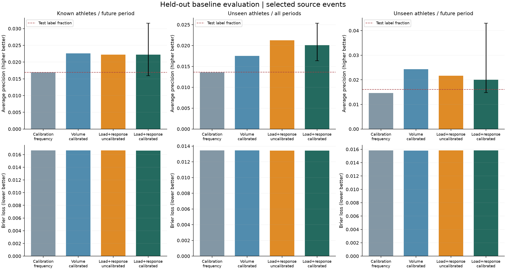
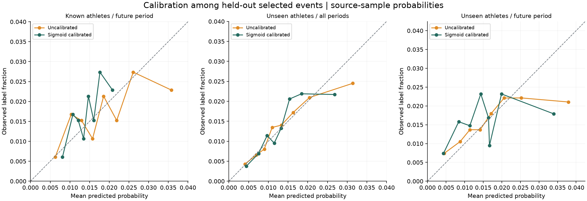
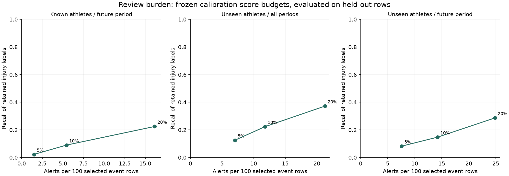

# Phase 2 - Exposure windows, validation and first probability baselines

**Project:** Longitudinal Training Load & Injury Risk in Competitive Runners  
**Date:** 2026-10-25  
**Status:** research baselines completed following the user's request to continue. No clinical deployment, causal advice, tree/neural models or cross-cohort pooling.

## Improvements implemented

1. Reproducible 7/14/21-day exposure summaries and week-to-week distance differences from original complete weekly blocks. No unstable acute:chronic ratios were introduced. Day remains the primary modeling representation; weekly features are prepared and described, not yet used in the model comparison.
2. A prior-only personal exposure ledger with at least 28 observed days inside a 56-day baseline window ending before the current seven-day window. Each source event's fitness ascertainment is conservatively delayed 21 days, without inspecting its label. Missing days remain missing. This source-conditional availability audit supports only a known-athlete sensitivity experiment; it does not recover a continuous real-world training log.
3. A locally recorded specification before fitting: [protocol](../config/phase_02_protocol.json). Hyperparameters, feature groups, validation rules, clipping quantiles, calibration and score-review budgets were fixed. Milestone 1 already inspected the entire dataset, so this is exploratory reuse, not prospective preregistration or an untouched external test.
4. Three separate evaluations: known athletes in a later period; five outer athlete-disjoint folds; and athlete-disjoint plus temporal restrictions. Calibration observations are separate from fitting and testing. All grouped roles are athlete-disjoint. Calendar cutoffs were chosen from the time range without outcome optimization.
5. Temporal purging respects both feature lookback and the source's 21-day future-conditioned healthy selection. Known-athlete models use a common 63-day maximum input envelope so personal-history and ordinary baselines share the same split. Other protocols use seven days. These safeguards prevent cross-boundary information overlap but cannot undo the dataset's upstream selection.
6. Fixed regularized logistic models and two constant frequency baselines. Training-only clipping (0.5th/99.5th percentiles), median imputation, missing indicators and robust scaling. No resampling or class weighting. Primary features omit training success because 15 athletes have all-zero histories; its inclusion is an explicit sensitivity analysis.
7. Sigmoid calibration on disjoint calibration data with a frozen base estimator. No test labels choose preprocessing, hyperparameters, calibration or review thresholds. Review thresholds depend only on calibration scores and fixed review budgets; ties are retained or excluded as complete groups.

## Main held-out results

Primary model: ten exposure features plus seven-day exertion and recovery; training-only clipping and sigmoid calibration. AP means non-interpolated average precision, not trapezoidal PR area. Confidence intervals use 500 athlete-cluster resamples of the held-out predictions. They are conditional on fitted models, do not refit training, and do not account for dependence between athletes in a common team.

| Validation | Athletes | Rows | Labels | Label fraction | Pooled AP | Mean fold AP | AP CI low | AP CI high | ROC-AUC | Brier |
|---|---|---|---|---|---|---|---|---|---|---|
| Known athletes / future period | 23 | 5254 | 89 | 0.0169 | 0.0222 | 0.0222 | 0.0159 | 0.0316 | 0.5839 | 0.0166 |
| Unseen athletes / all periods | 74 | 42766 | 583 | 0.0136 | 0.0201 | 0.0230 | 0.0164 | 0.0253 | 0.6330 | 0.0134 |
| Unseen athletes / future period | 32 | 7596 | 122 | 0.0161 | 0.0200 | 0.0239 | 0.0148 | 0.0430 | 0.5456 | 0.0158 |


The three evaluations test different populations/periods and have different label fractions. Their scores are not a causal decomposition of athlete versus temporal effects. The combined design includes 32 athletes with eligible later-period observations; this does not represent all athletes equally.



### Fair frequency references

Two constant baselines are reported: fitting-period prevalence, and calibration-period prevalence (the latter has access to the same calibration labels as the calibrated model). The horizontal figure reference is the evaluation label fraction. Fold-specific constant probabilities can differ, so pooled out-of-fold AP need not equal pooled prevalence; mean fold AP is also shown. Neither is a prospective cohort incidence.

| protocol | No-skill pooled AP | No-skill Brier |
|---|---|---|
| known_temporal | 0.0169 | 0.0167 |
| unseen_athlete | 0.0136 | 0.0134 |
| unseen_athlete_temporal | 0.0146 | 0.0158 |


The model has limited ranking signal within this selected source sample. Small Brier values are expected when positives are rare; compare them with the constant baseline. Brier loss combines calibration and discrimination and does not establish calibration by itself. Bootstrap differences versus the calibration-frequency baseline appear in [paired uncertainty](phase_02/tables/primary_cluster_bootstrap.csv).

## Calibration is a comparison, not an automatic improvement

Uncalibrated and calibrated versions are both retained. Sigmoid calibration changes the probability scale and may improve or worsen held-out Brier, AP and ranking across different fold-specific models. It is not assumed beneficial. Sparse positive calibration cases and between-athlete differences remain important; inspect [partition event counts](phase_02/tables/split_audit.csv).



These are source-sample calibration curves with quantile bins, not validated clinical risk curves. Bin counts and observed positives are exported. No independent-row confidence intervals are drawn on correlated records.

## Sensitivity analysis

| protocol | model | average_precision | roc_auc | brier |
|---|---|---|---|---|
| known_temporal | logistic_load_response_sigmoid | 0.0222 | 0.5839 | 0.0166 |
| known_temporal | logistic_personal_baseline_sensitivity_sigmoid | 0.0238 | 0.5677 | 0.0166 |
| known_temporal | logistic_success_sensitivity_sigmoid | 0.0222 | 0.5804 | 0.0166 |
| known_temporal | logistic_uncapped_sensitivity_sigmoid | 0.0208 | 0.5763 | 0.0166 |
| unseen_athlete | logistic_load_response_sigmoid | 0.0201 | 0.6330 | 0.0134 |
| unseen_athlete | logistic_success_sensitivity_sigmoid | 0.0200 | 0.6317 | 0.0134 |
| unseen_athlete | logistic_uncapped_sensitivity_sigmoid | 0.0188 | 0.6158 | 0.0143 |
| unseen_athlete_temporal | logistic_load_response_sigmoid | 0.0200 | 0.5456 | 0.0158 |
| unseen_athlete_temporal | logistic_success_sensitivity_sigmoid | 0.0204 | 0.5485 | 0.0158 |
| unseen_athlete_temporal | logistic_uncapped_sensitivity_sigmoid | 0.0199 | 0.5510 | 0.0160 |


Treat differences as exploratory. The personal-history sensitivity is restricted to known athletes, replaces total distance with a prior expected level and current deviation, and allows earlier unlabeled exposures to update history during evaluation. It is not a cold-start model for new athletes. It is also not a mixed-effects estimate of within/between-person causal effects. Training success is retained unchanged in its sensitivity; zeros are not silently reclassified as missing. The uncapped comparison changes preprocessing only, not which rows are evaluated.

## Review burden in the selected sample

Budgets of 5%, 10% and 20% were applied to calibration scores. Actual test alert volume can shift. Alerts are counted **per 100 selected event rows**, not per 100 true athlete-days, and captured positive rows are retained labels rather than a complete clinical injury registry. Precision is reported as zero by convention when no alerts occur. No low/moderate/high clinical categories were invented.

| protocol | requested_budget | alerts | alerts_per_100_selected_rows | true_positive_rows | false_positive_rows | precision | recall | alerts_per_captured_positive |
|---|---|---|---|---|---|---|---|---|
| known_temporal | 0.050 | 79 | 1.504 | 2 | 77 | 0.025 | 0.022 | 39.500 |
| known_temporal | 0.100 | 286 | 5.443 | 8 | 278 | 0.028 | 0.090 | 35.750 |
| known_temporal | 0.200 | 848 | 16.140 | 20 | 828 | 0.024 | 0.225 | 42.400 |
| unseen_athlete | 0.050 | 3007 | 7.031 | 73 | 2934 | 0.024 | 0.125 | 41.192 |
| unseen_athlete | 0.100 | 5038 | 11.780 | 130 | 4908 | 0.026 | 0.223 | 38.754 |
| unseen_athlete | 0.200 | 9098 | 21.274 | 217 | 8881 | 0.024 | 0.372 | 41.926 |
| unseen_athlete_temporal | 0.050 | 575 | 7.570 | 10 | 565 | 0.017 | 0.082 | 57.500 |
| unseen_athlete_temporal | 0.100 | 1082 | 14.244 | 18 | 1064 | 0.017 | 0.148 | 60.111 |
| unseen_athlete_temporal | 0.200 | 1889 | 24.868 | 35 | 1854 | 0.019 | 0.287 | 53.971 |




## Personal-history feasibility and exclusions

27,096 of 42,766 original Day records have sufficient prior source-confirmed exposure for the specified personal baseline. Availability by athlete is exported, and missing personal values are handled only by fitting-period imputation in the sensitivity. The original retrospective visualization table is not used as a ready-made predictor stream. No future athlete averages or future injury counts enter predictors.

Known-athlete temporal evaluation retains 5,254 later-period rows and excludes 2,342 later rows belonging to athletes absent from the fitting period. Those athletes are evaluated by the separate unseen-athlete designs. Time purging also excludes boundary records from fitting/calibration. All row assignments and model predictions are retained locally under `data/processed/phase_02/`.

## What to improve next

- Add a matched-event comparison of original weekly 14/21-day load/change features versus daily windows using the same eligibility, folds and cutoff rules. Their prepared features currently have not entered the baseline comparison.
- Evaluate stability over prespecified alternative temporal cutoffs and athlete partitions. Also test athlete-balanced training weights so long histories do not dominate fitting. The present intervals capture held-out athlete heterogeneity, not full model-development uncertainty. Avoid selecting a favorable seed or reporting only one model's best split.
- Audit the cause of extreme sprint/cross-training values and constant subjective scales with source documentation; use transparent sensitivity handling until clarified. Personal-baseline coverage remains selective and needs better raw continuous surveillance.
- Consider repeated-measures associations that distinguish prior personal level and deviation; do not interpret logistic coefficients as causal effects. Tree models would be a later comparison only after these baselines, with identical validation.
- Representative prospective logging and complete clinical ascertainment remain necessary before calendar-day probabilities, injury-event lead time, false alerts per athlete-month or clinical review thresholds can be validated.
- Keep SoccerMon as a separate wellness/session source. Wu processed workbooks lack explicit athlete/time keys and remain quarantined. Neither fills missing modalities in the Dutch runners.

## Reproduce

```powershell
python -m pip install -r requirements.txt
python -m pytest -q
python scripts/run_phase_02.py
python scripts/write_phase_02_report.py
python scripts/execute_notebooks.py --start 5 --end 9
python scripts/verify_delivery.py
```

Original acquisition and Milestone 1 descriptive scripts remain documented in README. Numeric source files, the frozen protocol and original manifest are hashed in [run manifest](phase_02/run_manifest.json); no fitted model is serialized or deployed. Local predictions are retained for audit, not used to retrospectively choose a winner.

References: [group-aware cross-validation](https://scikit-learn.org/stable/modules/generated/sklearn.model_selection.GroupKFold.html), [probability calibration and disjoint calibration data](https://scikit-learn.org/stable/modules/calibration.html), [AP definition](https://scikit-learn.org/stable/modules/generated/sklearn.metrics.average_precision_score.html). Source sampling limitations and injury definition remain in [Milestone 1](milestone_01_summary.md).
